# COVID-19 Statistical Surveillance System for Ghana

This project develops a statistical surveillance framework for monitoring COVID-19 transmission patterns in Ghana using daily epidemiological data from the [Our World in Data (OWID) COVID-19 dataset](https://github.com/owid/covid-19-data). The study applies descriptive statistics, exploratory data analysis, rolling time-series indicators, statistical threshold monitoring, correlation analysis, and multiple linear regression to examine reported disease activity and its relationship with selected public health indicators.

The analysis uses 190 country-level observations covering the period from 13 March 2020 to 19 September 2020. Six variables were selected for the principal analysis: date, new cases, new deaths, new tests, positive rate, and stringency index.

A statistical surveillance framework was developed using a seven-observation moving average and a 14-observation rolling window. Dynamic warning and alert thresholds were constructed using the rolling mean and standard deviation. These thresholds were used to classify transmission activity and identify observations that exceeded the monitoring limits.

The surveillance analysis identified 67 warning signals and 14 alert signals. Eleven distinct alert periods were identified, with the longest occurring between 8 July and 10 July 2020. Among the 171 observations with valid rolling thresholds, warning signals represented approximately 39.18% and alert signals represented 8.19%.

Correlation and multiple regression analyses were also conducted using 113 complete observations. Positivity rate demonstrated a moderate positive association with reported cases and was statistically significant in the regression model. Testing volume had a statistically significant positive regression coefficient, while the stringency index had a negative coefficient that did not reach statistical significance at the 5% level.

The project demonstrates how applied statistical techniques can be used to develop interpretable disease-monitoring indicators, examine epidemiological relationships, and support evidence-informed public health surveillance. The framework is an analytical demonstration based on historical data rather than a deployed real-time surveillance system.

---

## Research Objectives

The primary objective is to develop a statistical surveillance framework for monitoring reported COVID-19 activity in Ghana and identifying observations that exceed dynamically calculated statistical thresholds.

The specific objectives are to:

1. Examine temporal trends and variability in daily reported COVID-19 cases and deaths.
2. Assess testing activity, positivity rates, and government response measures during the study period.
3. Develop a statistical monitoring framework using moving averages and rolling control limits.
4. Identify warning and alert signals associated with elevated reported case activity.
5. Classify observations into four statistical surveillance risk categories.
6. Investigate relationships between reported cases, testing activity, positivity rates, and the government stringency index.
7. Evaluate the potential usefulness and limitations of statistical monitoring techniques for public health surveillance.

## Dataset Description

The dataset was obtained from the Our World in Data COVID-19 repository. The original dataset contains country-level daily observations and epidemiological, testing, policy, demographic, and health-related indicators.

A Ghana-specific subset was extracted for this project.

### Dataset Characteristics

| Metric | Value |
|---|---:|
| Country | Ghana |
| Original dataset observations | 44,785 |
| Original dataset variables | 41 |
| Ghana observations | 190 |
| Variables in the selected analytical dataset | 6 |
| Study period | 13 March 2020 – 19 September 2020 |

### Variables Used

| Variable | Description |
|---|---|
| `date` | Observation date |
| `new_cases` | Daily reported COVID-19 cases |
| `new_deaths` | Daily reported COVID-19 deaths |
| `new_tests` | Daily COVID-19 tests conducted |
| `positive_rate` | Share of COVID-19 tests that returned positive |
| `stringency_index` | Composite measure of government response stringency |

### Data Quality Assessment

The selected dataset contained missing observations in three variables.

| Variable | Missing Values | Missing Percentage |
|---|---:|---:|
| `new_tests` | 66 | 34.74% |
| `positive_rate` | 16 | 8.42% |
| `stringency_index` | 16 | 8.42% |
| `date` | 0 | 0.00% |
| `new_cases` | 0 | 0.00% |
| `new_deaths` | 0 | 0.00% |

The exploratory and surveillance analyses used the available case and death observations. For correlation and regression analysis, observations with missing values in the selected model variables were excluded through complete-case deletion, leaving 113 observations.

Missing observations were not treated as zero because an unreported measurement should not automatically be interpreted as an absence of testing or disease activity.

---

## Methodology

The project was organized into six analytical stages.

### Stage 1: Data Acquisition and Understanding

The original OWID COVID-19 dataset was loaded and inspected. The Ghana-specific subset was extracted using the country location field.

The initial assessment examined:

- Dataset dimensions and variable names
- Country-level observation availability
- Date coverage
- Data types
- Descriptive characteristics of the selected variables

### Stage 2: Data Cleaning and Preparation

The Ghana observations were isolated, relevant variables were selected, and the date field was converted into a datetime format where required.

Missing values were assessed before analysis. For the driver and policy analysis, complete-case deletion was applied to the variables included in the correlation and regression models.

### Stage 3: Exploratory Data Analysis

Descriptive statistics and visualizations were used to investigate:

- Daily reported cases
- Daily reported deaths
- Seven-observation moving averages
- Distributions of reported cases and deaths
- Changes in reported outbreak activity over time

### Stage 4: Statistical Surveillance Framework

A seven-observation moving average was constructed to smooth short-term fluctuations in reported daily cases.

A 14-observation rolling window was then used to calculate:

- Rolling mean
- Rolling standard deviation
- Upper warning limit
- Upper alert limit

The thresholds were defined as:

**Warning limit**

`Rolling Mean + 1 × Rolling Standard Deviation`

**Alert limit**

`Rolling Mean + 2 × Rolling Standard Deviation`

These dynamic thresholds were used to evaluate reported case activity relative to the recent rolling baseline.

### Stage 5: Early Warning Signal Detection

Observations were classified as warning or alert signals when the seven-observation moving average met or exceeded the corresponding statistical threshold.

Consecutive alert observations were grouped to identify distinct alert periods and examine their duration.

### Stage 6: Statistical Driver and Policy Analysis

Correlation and multiple linear regression analyses were conducted to examine relationships between reported cases and selected indicators.

The methods included:

- Pearson correlation analysis
- Correlation matrix visualization
- Pearson correlation significance testing
- Multiple linear regression using ordinary least squares
- Examination of the government Stringency Index

---

## Exploratory Data Analysis

Exploratory Data Analysis was conducted to understand the temporal patterns, distributions, and variability of COVID-19 indicators in Ghana.

### Descriptive Statistics

The descriptive statistics for daily reported cases were:

| Statistic | New Cases |
|---|---:|
| Mean | 241.35 |
| Median | 128.00 |
| Maximum | 1,513 |
| Standard Deviation | 293.91 |

The mean daily case count was substantially higher than the median, indicating a right-skewed distribution with a relatively small number of high-case observations.

### Key Observations

- Daily reported cases varied substantially throughout the study period.
- Reported case activity increased from March through July 2020.
- Several periods of elevated case activity occurred between June and August.
- The highest reported daily case count was 1,513.
- Daily reported deaths were generally lower in magnitude, with a maximum of 15.
- The seven-observation moving average provided a smoother representation of reported case activity.
- The moving-average trend suggested peak activity around late July to early August 2020, followed by a decline toward September.

### Visualizations

#### Daily COVID-19 Cases

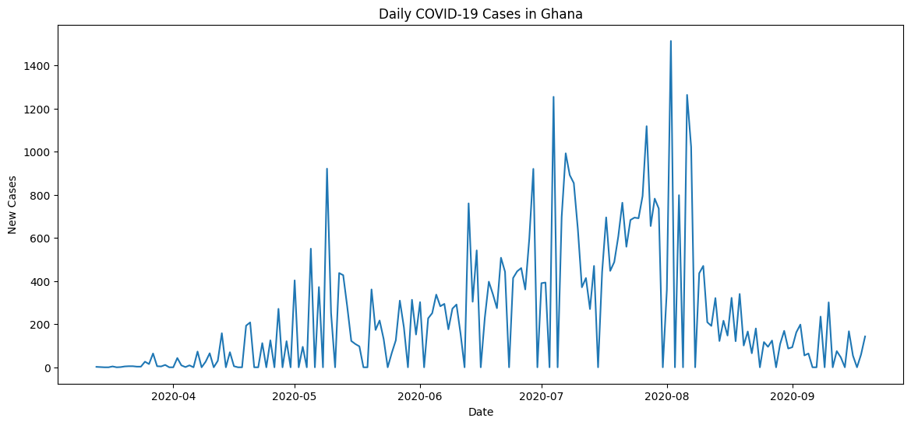

#### Daily COVID-19 Deaths

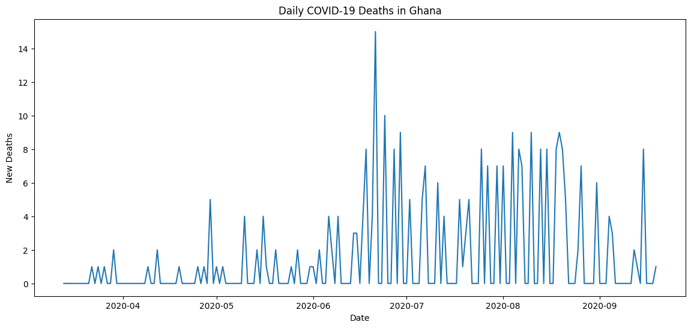

#### Seven-Observation Moving Average of Cases

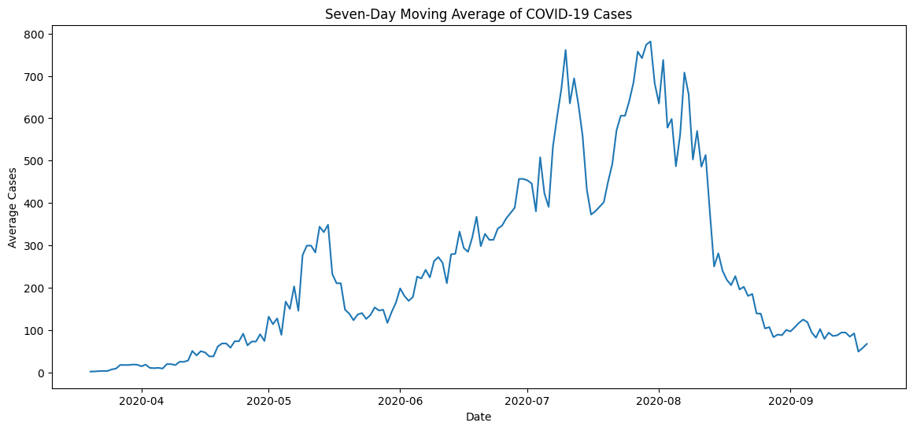

#### Distribution of Daily Cases

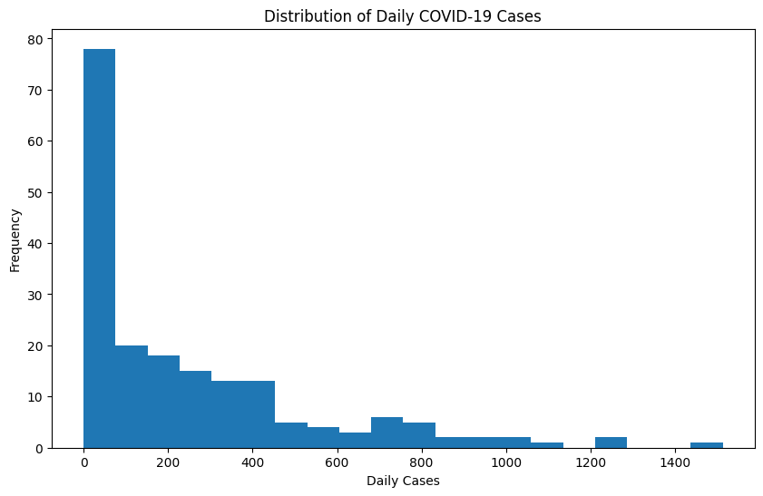

---

## Statistical Surveillance Framework

A rolling statistical surveillance framework was developed to monitor changes in reported COVID-19 case activity.

The framework uses a seven-observation moving average as its primary monitoring indicator. A 14-observation rolling window is subsequently used to estimate the local mean and standard deviation.

This approach allows the monitoring thresholds to adapt to changes in recent reported case activity rather than relying on one fixed threshold for the entire study period.

### Surveillance Components

The framework calculates:

1. Seven-observation moving average of reported cases.
2. Fourteen-observation rolling mean.
3. Fourteen-observation rolling standard deviation.
4. Upper warning limit.
5. Upper alert limit.

### Statistical Thresholds

| Indicator | Definition |
|---|---|
| Rolling mean | Mean of the preceding 14 moving-average observations |
| Rolling standard deviation | Standard deviation of the preceding 14 moving-average observations |
| Warning limit | Rolling mean + 1 standard deviation |
| Alert limit | Rolling mean + 2 standard deviations |

### Risk Classification Framework

Each observation with valid rolling statistics is assigned to one of four categories.

| Risk Level | Classification Rule |
|---|---|
| Low | Moving average is below the rolling mean |
| Moderate | Moving average is at or above the rolling mean but below the warning limit |
| High | Moving average is at or above the warning limit but below the alert limit |
| Critical | Moving average is at or above the alert limit |

These categories represent statistical surveillance states defined by the project's threshold rules. They should not be interpreted as clinically validated severity categories or official epidemiological outbreak declarations.

### Risk Distribution

A total of 171 observations had valid rolling surveillance thresholds and were assigned risk categories.

| Risk Level | Observations | Percentage |
|---|---:|---:|
| Low | 72 | 42.11% |
| Moderate | 32 | 18.71% |
| High | 53 | 30.99% |
| Critical | 14 | 8.19% |
| **Total** | **171** | **100.00%** |

Low-risk observations represented the largest category, while approximately 39.18% of classified observations were categorized as High or Critical.

### Surveillance Visualizations

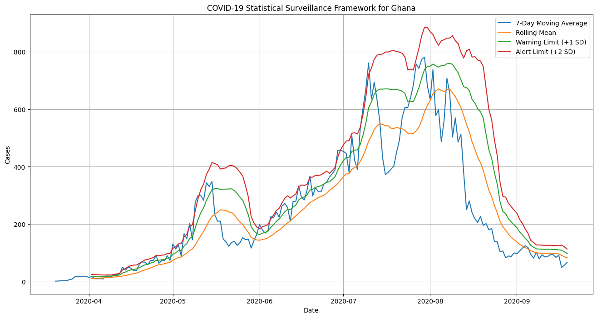

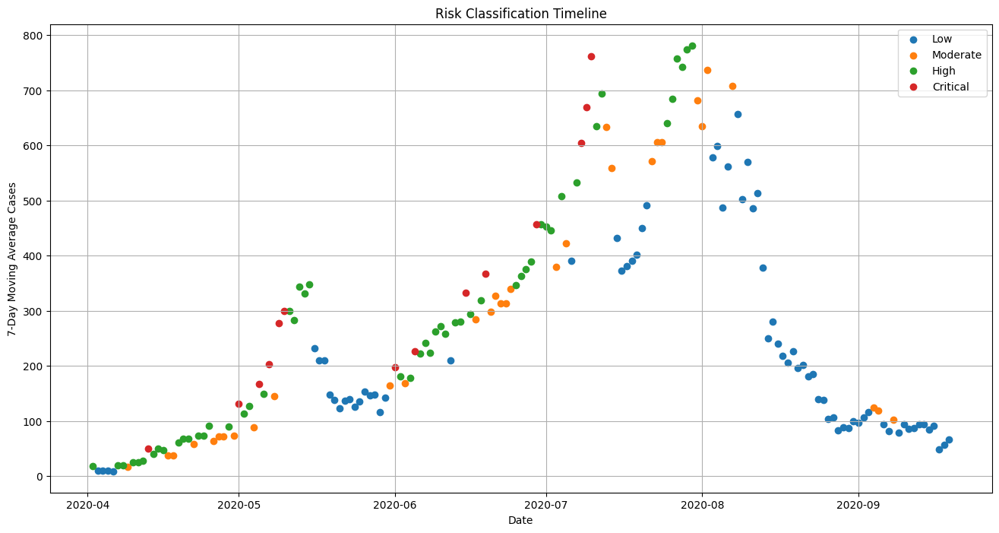

---

## Early Warning Signal Detection

The early warning component identifies observations in which the seven-observation moving average meets or exceeds the calculated warning or alert threshold.

The purpose is to identify periods of statistically elevated reported case activity that may warrant further epidemiological investigation.

### Signal Detection Results

| Indicator | Observations |
|---|---:|
| Warning signals | 67 |
| Alert signals | 14 |
| Distinct alert periods | 11 |

The notebook's original percentage calculation used 184 observations with a valid seven-observation moving average. However, rolling surveillance thresholds were available for only 171 observations.

Using the 171 threshold-eligible observations as the denominator gives:

| Signal Type | Count | Percentage of Threshold-Eligible Observations |
|---|---:|---:|
| Warning | 67 | 39.18% |
| Alert | 14 | 8.19% |

The percentage calculation should use observations for which the corresponding rolling threshold is defined. This avoids treating observations with unavailable thresholds as monitored days without signals.

### Alert Period Analysis

Eleven distinct alert periods were identified.

The longest alert period occurred between:

- **Start date:** 8 July 2020
- **End date:** 10 July 2020
- **Duration:** 3 consecutive observations

### Alert Duration Summary

| Statistic | Duration |
|---|---:|
| Number of alert periods | 11 |
| Mean duration | 1.27 observations |
| Median duration | 1 observation |
| Maximum duration | 3 observations |

Most alert periods lasted for one observation. The longest period lasted three consecutive observations.

These results indicate that the framework identified several episodes in which the moving average exceeded the alert threshold, although most were brief.

### Early Warning Visualization

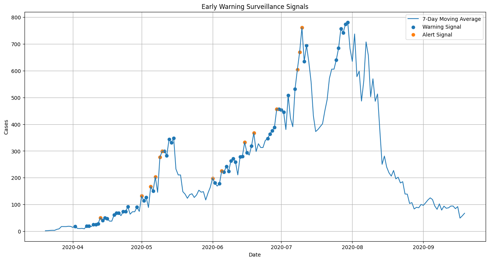

---

## Statistical Drivers of COVID-19 Transmission

Correlation analysis and multiple linear regression were used to examine relationships between daily reported COVID-19 cases, testing activity, positivity rates, and government response measures.

The analysis used 113 complete observations after excluding records with missing values in the selected variables.

### Correlation Analysis

Pearson correlation coefficients were calculated to assess the direction and strength of linear relationships.

| Relationship | Pearson Correlation |
|---|---:|
| Cases vs. Tests | -0.033 |
| Cases vs. Positivity Rate | 0.444 |
| Cases vs. Stringency Index | -0.279 |

### Correlation Findings

- Positivity rate showed the strongest positive linear association with reported cases among the three indicators examined.
- Testing volume showed an almost negligible negative linear correlation with daily reported cases.
- The Stringency Index demonstrated a negative association with reported cases.
- Testing volume and stringency measures were positively correlated with one another.
- Positivity rate and stringency measures demonstrated a moderate negative association.

### Statistical Significance

Pearson correlation tests produced the following results:

| Relationship | p-value |
|---|---:|
| Tests vs. Cases | 0.728 |
| Positivity Rate vs. Cases | < 0.001 |
| Stringency Index vs. Cases | 0.0027 |

The relationship between positivity rate and reported cases was statistically significant. The negative bivariate association between stringency and cases was also statistically significant.

The relationship between testing volume and cases was not statistically significant.

### Correlation Matrix

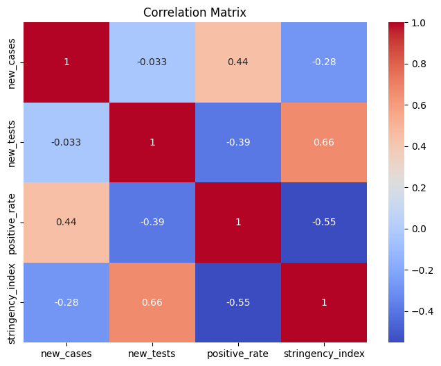

### Supporting Visualizations

#### Testing Activity and Reported Cases

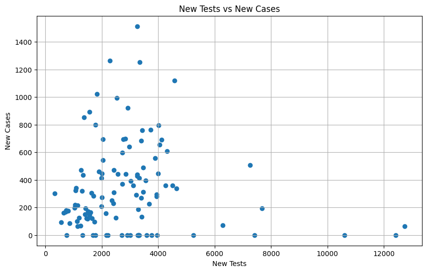

#### Positivity Rate and Reported Cases

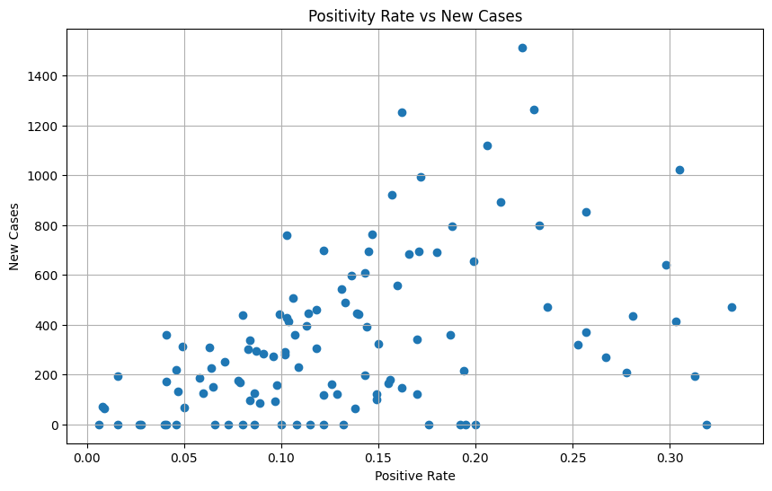

#### Government Stringency and Reported Cases

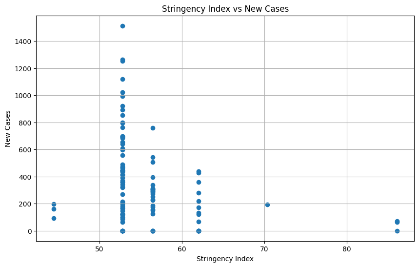

---

## Multiple Regression Analysis

Multiple linear regression was used to examine the combined statistical associations of testing activity, positivity rate, and government response stringency with daily reported COVID-19 cases.

An ordinary least squares (OLS) model was estimated using 113 complete observations.

### Model Specification

The dependent variable was:

- `new_cases`

The explanatory variables were:

- `new_tests`
- `positive_rate`
- `stringency_index`

### Model Performance

| Metric | Value |
|---|---:|
| R-squared | 0.246 |
| Adjusted R-squared | 0.225 |
| F-statistic | 11.84 |
| F-statistic p-value | < 0.001 |
| Number of observations | 113 |

The model explained approximately 24.6% of the observed variation in daily reported cases.

### Regression Results

| Predictor | Coefficient | p-value |
|---|---:|---:|
| New Tests | 0.0445 | 0.011 |
| Positive Rate | 1,790.31 | < 0.001 |
| Stringency Index | -11.60 | 0.059 |

### Interpretation

**Positivity rate**

Positivity rate had a positive and statistically significant coefficient. It was the strongest predictor by statistical significance and coefficient magnitude in the fitted model, although the raw coefficients are measured on different scales and should not be compared directly as standardized effect sizes.

**Testing activity**

Testing volume had a positive and statistically significant coefficient after controlling for positivity rate and stringency. This indicates a positive conditional association with reported cases in the fitted model. It does not establish that increased testing caused increased transmission.

**Government stringency**

The Stringency Index had a negative coefficient, suggesting an inverse conditional association with reported case counts. However, its p-value of 0.059 did not meet the conventional 5% significance threshold in the multiple regression model.

This differs from the statistically significant negative bivariate correlation. The distinction illustrates why the relationship between two variables may change after accounting for other explanatory variables.

### Model Interpretation and Limitations

The model provides evidence of statistical associations among the selected indicators. However, the results should be interpreted cautiously because:

- The model uses a relatively small complete-case sample of 113 observations.
- The analysis is observational and does not establish causal relationships.
- The predictors may be correlated with one another.
- The reported OLS diagnostics indicate a high condition number, suggesting potential numerical or multicollinearity concerns.
- The model uses non-robust standard errors.
- Temporal dependence and other time-varying factors may affect the estimates.

The regression findings should therefore be treated as exploratory evidence rather than causal estimates of the effects of testing or government interventions.

---

## Key Findings

### Surveillance Findings

- The framework identified 67 warning signals.
- Fourteen alert signals were detected.
- Eleven distinct alert periods were identified.
- The longest alert period occurred between 8 July and 10 July 2020.
- The longest alert period lasted three consecutive observations.
- The mean alert-period duration was approximately 1.27 observations.

### Risk Classification Findings

Among 171 observations with valid rolling thresholds:

- Low Risk: 42.11%
- Moderate Risk: 18.71%
- High Risk: 30.99%
- Critical Risk: 8.19%

### Statistical Findings

- Positivity rate demonstrated a moderate positive association with daily reported cases.
- Testing volume showed almost no bivariate linear association with reported cases.
- The bivariate association between stringency and reported cases was negative and statistically significant.
- In the multiple regression model, testing activity and positivity rate had statistically significant positive coefficients.
- The Stringency Index had a negative coefficient that did not reach statistical significance at the 5% level.
- The regression model explained approximately 24.6% of the variation in daily reported cases.

### Public Health Relevance

The findings illustrate the potential value of combining reported case counts with positivity rates and other public health indicators when monitoring disease activity.

The statistical surveillance framework also demonstrates how rolling averages and adaptive thresholds can be used to identify observations that depart from recent reported patterns.

These signals should be interpreted alongside epidemiological context, testing practices, reporting changes, and other relevant public health information.

---

## Public Health Recommendations

### Strengthen Positivity Rate Monitoring

Positivity rate showed a consistent positive association with reported case counts and was statistically significant in the multiple regression model. It may therefore provide useful supplementary information for monitoring reported disease activity.

### Maintain Statistical Surveillance Frameworks

Rolling averages and dynamic statistical thresholds can support the identification of unusual changes in reported case activity. Such frameworks should complement, rather than replace, established epidemiological surveillance procedures.

### Improve Data Completeness

Missing testing observations reduced the available sample for the driver and policy analysis. More complete and consistent reporting would improve the information available for statistical assessment.

### Support Evidence-Informed Decision-Making

Statistical monitoring indicators can help public health analysts identify changes that warrant further investigation. Interpretation should incorporate epidemiological knowledge and the limitations of the underlying data.

### Extend the Analytical Framework

The approach can be investigated for application to other infectious diseases and public health monitoring settings, subject to appropriate data availability and disease-specific validation.

---

## Technologies Used

### Programming Language

- Python

### Data Analysis

- pandas
- NumPy

### Statistical Analysis

- SciPy
- Statsmodels

### Data Visualization

- Matplotlib
- Seaborn

### Development Environment

- Google Colab
- Jupyter Notebook

### Version Control

- Git
- GitHub

---

## Limitations and Future Research Directions

The project provides an analytical demonstration of statistical surveillance using historical COVID-19 observations. Several limitations should be considered when interpreting its findings.

### Data Completeness and Reporting

Missing observations in testing-related variables reduced the sample available for correlation and regression analysis. Reported case counts may also be influenced by changes in testing coverage, reporting practices, and case ascertainment.

### Rolling Window Assumptions

The surveillance framework uses seven-observation and 14-observation rolling windows. These are row-based windows, and the source dataset contains 190 records across a 191-day calendar interval. The rolling calculations should therefore not be assumed to represent perfectly continuous calendar-day intervals.

### Statistical Threshold Validation

The warning and alert thresholds are based on rolling means and standard deviations. They are analytical monitoring rules and have not been validated against an independent epidemiological outbreak definition.

### Regression Model Limitations

The regression model has moderate explanatory power and potential numerical or multicollinearity concerns. The observational design also limits causal interpretation.

### Advanced Time-Series Modeling

Future research could compare the rolling surveillance approach with ARIMA, state-space, and Bayesian time-series models to investigate alternative approaches to outbreak monitoring and forecasting.

### Spatial Surveillance

Regional or district-level data could be integrated to investigate geographic variation, spatial dependence, and localized transmission patterns.

### Machine Learning Approaches

Machine learning methods could be explored for anomaly detection, outbreak classification, and predictive surveillance, with appropriate temporal validation.

### Real-Time Monitoring Dashboard

The analytical framework could be extended into an interactive dashboard for monitoring updated epidemiological observations. Such an implementation would require a reliable data pipeline, automated validation, and a more extensive evaluation of surveillance performance.

### Multi-Disease Surveillance

The framework could be adapted to other infectious diseases, including influenza, cholera, and malaria, subject to disease-specific statistical and epidemiological considerations.

---

## References

1. Our World in Data. COVID-19 Dataset. [https://github.com/owid/covid-19-data](https://github.com/owid/covid-19-data).

2. Hasell, J., Mathieu, E., Beltekian, D., et al. (2020). A cross-country database of COVID-19 testing. *Scientific Data, 7*, 345.

3. World Health Organization. (2022). *Public Health Surveillance for COVID-19: Interim Guidance*. Geneva: WHO.

4. World Health Organization. (2022). *End-to-End Integration of SARS-CoV-2 and Influenza Sentinel Surveillance: Revised Interim Guidance*. Geneva: WHO.

5. World Health Organization. (2022). *Environmental Surveillance for SARS-CoV-2 to Complement Public Health Surveillance*. Geneva: WHO.

---

## Conclusion

This project demonstrates the application of statistical methods to historical COVID-19 surveillance data from Ghana. Through exploratory analysis, rolling statistical indicators, threshold-based signal detection, correlation analysis, and multiple linear regression, the study examines changes in reported disease activity and relationships among selected public health indicators.

The resulting framework illustrates how statistical techniques can transform routine epidemiological observations into interpretable monitoring indicators. It also highlights the importance of data completeness, appropriate statistical interpretation, and validation when developing analytical systems for public health decision support.
